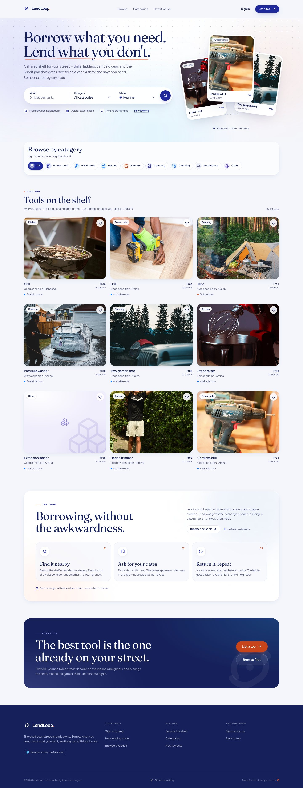

# UI system — LendLoop



The public surface is designed to feel like a neighbourhood product, not a
dashboard: a warm page, editorial display type, real photography, and one
obvious action on every screen. This note records the decisions so the next UI
change extends the system instead of restyling around it.

More captures: [listing detail](./ui/listing.jpg), [search focus](./ui/search-focus.jpg),
[category picker](./ui/search-category.jpg), [mobile](./ui/landing-mobile.jpg). Captures are from a
production build so they do not include the dev overlay.

## Palette

Source of truth: the brand sheet already used by the transactional email
templates (`convex/lib/emailTemplates.ts`) and the token set below.

| Token           | Value     | Use                                                     |
| --------------- | --------- | ------------------------------------------------------- |
| `brand`         | `#1F299C` | Primary actions, active states, links on light surfaces |
| `navy`          | `#16215B` | Headings, body ink, the footer and dark CTA panel       |
| `orange`        | `#F25929` | Accent marks, returns, hearts, "the loop"               |
| `orange-strong` | `#C8451B` | White-on-orange body text (AA contrast)                 |
| `blue`          | `#0373FF` | Available state                                         |
| `cyan`          | `#30D1FF` | Quiet support in the footer/CTA glow                    |
| `lilac`         | `#A3A9F5` | Ambient light, selection                                |
| `mist`          | `#E0EAF8` | Soft surfaces, tags, placeholder grounds                |
| `page`          | `#F4F6FC` | The page                                                |
| `rule`          | `#E4E8F5` | Hairlines and borders                                   |
| `ink-muted`     | `#565B85` | Secondary text                                          |

Raw `#F25929` is not used behind white body-size text: the `accent` button and
other small labels use `orange-strong` so the text passes AA. The token names
are declared in `app/globals.css` under `@theme`, which also keeps the older
`accent`/`surface` aliases working for the authenticated screens.

## Type

- **Body / UI:** Manrope, loaded through `next/font/google` as
  `--font-manrope`. Numbers that move (counts, dates) use `tabular-nums`.
- **Display:** **GT Alpina** is the intended heading face. It is a licensed
  Grilli Type family and is deliberately not bundled. The stack is
  `"GT Alpina", var(--font-fraunces), Fraunces, Georgia, serif`, so a licensed
  copy is picked up automatically when a local `@font-face` is added.
- **Bundled stand-in:** Fraunces, with the `SOFT`/`WONK` axes pinned to 0 and
  optical sizing on, gives the same high-contrast editorial temperature.

To add the real face, put the licensed files in `public/fonts/` and add this
before the `@theme` block in `app/globals.css`; no component changes are needed:

```css
@font-face {
  font-family: "GT Alpina";
  src: url("/fonts/GT-Alpina-Standard-Regular.woff2") format("woff2");
  font-weight: 400;
  font-style: normal;
  font-display: swap;
}
@font-face {
  font-family: "GT Alpina";
  src: url("/fonts/GT-Alpina-Standard-Bold.woff2") format("woff2");
  font-weight: 700;
  font-style: normal;
  font-display: swap;
}
```

Display headings use `.font-display`. Body copy is Manrope with a `15px/1.7`
base rhythm; headings use tight tracking (`-0.022em`) and a near-1 line height.

## Structure

| Route                                                          | What it is                                                                                        |
| -------------------------------------------------------------- | ------------------------------------------------------------------------------------------------- |
| `/`                                                            | Public landing: hero, three-part search, category rail, live shelf, how it works, lend CTA        |
| `/listings/[id]`                                               | Public item page: gallery, owner, description, details, availability, request card, related shelf |
| `/my-listings`, `/my-requests`, `/incoming-requests`, `/admin` | Authenticated views                                                                               |
| `/api/health`                                                  | Service status                                                                                    |

The old `/tools` browse page is gone; `/tools` redirects to the public shelf, and the
signed-in nav’s Browse link goes there. Every **shelf** item card links to its own item URL; hero cards are category shortcuts. The landing mirrors filters into
`/?q=…&category=…` with `history.replaceState`, so a search result is
shareable without a server round-trip. Invalid or removed listing ids resolve
to a branded 404.

## Hero

The opening section is a split editorial composition, not a centered banner:

- **No top pill.** The old “neighbourhood shelf / N tools” eyebrow is removed. The headline, a
  shorter deck, the search and the trust line are the left column.
- **Real cards, not stock.** `pickFeaturedListings` picks three available listings with covers,
  one per category (`power_tools`, `kitchen`, `camping`, then garden/cleaning as fallbacks),
  preferring established listings. Every card shows its real photo, category and condition, plus
  “Trusted lender” for a trusted owner — never a name. No image is invented for the hero.
- **Cards are category shortcuts.** Clicking any hero card — desktop fan, mobile photo stack or
  mobile card rail — does **not** open the item page. It sets the category, updates the URL and
  smooth-scrolls to the category section so the clicked category is active and centred. The down
  arrow on hover signals the jump; the shelf item cards still link to their own detail pages.
- **The loop.** A dashed elliptical orbit with a slowly travelling orange dot sits behind the
  cards; a “Borrow · Lend · Return” caption with the loop mark anchors it. Each card floats on an
  independent slow cycle; hover brings it forward, straightens it and shows a small arrow.
- **The pointer loop.** `components/landing/hero-cursor-loop.tsx` adds a decorative canvas behind
  the hero content. A soft halo follows the cursor, two counter-phased trails orbit on the same
  tilted ellipse as the card orbit, a dashed outer loop drifts around them, and small sparks peel
  off when the pointer moves. The canvas is pointer-events-none and sits below the text, search and
  cards, so readability and every control are untouched. It starts only for fine pointers
  (mouse/pen), fades out at the hero edge, and pauses when the hero is off screen or the tab is
  hidden. Coarse pointers get no effect at all.
- **Mobile.** A small stack of the three real photos sits above the search on phones. Below the
  trust row, the same listings become a swipeable card rail.
- **Reduced motion.** Floats, the travelling dot and the pointer loop are disabled; the
  composition stays.

## Interaction rules

- **Header:** the hero header scrolls away; a compact floating header appears
  after ~170px with blur, a compact search trigger, and the same navigation.
  It is one component (`components/site-header.tsx`), including the mobile
  sheet, so auth state cannot drift between bars.
- **Search:** Airbnb-shaped pill with What / Category / Where. One
  `layoutId="search-focus"` highlight slides between segments; the active
  segment widens. Category opens a compact grid of categories; Where has exactly one
  answer, **Near me**, because location search is not implemented. Search
  updates immediately as you type; Enter scrolls to the shelf.
- **Buttons:** every action pill uses `.btn-travel` — a second colour sweeps in
  from the left on hover/focus/active, and the icon travels with it. Press
  nudges the whole control down 1px. No JS is needed for the effect.
- **Cards:** a single overlay link makes the whole card clickable without
  nesting a button in an anchor. The save control is a sibling above the link,
  not inside the hover-transformed media box (that transform would trap it
  underneath the link).
- **Reveals:** sections animate position only, never opacity, so content is
  never invisible when a section has not been scrolled into view (screenshots,
  print, reduced JS). `prefers-reduced-motion` disables transitions.
- **Skeletons:** one `.skeleton` sheen, used on the shelf, card media, the
  listing loading route, and the request card while Clerk resolves.
- **Toasts:** Sonner, mounted once in `app/providers.tsx`; used for request
  success/failure, saves and share links.
- **Confirmations:** `components/ui/alert-dialog.tsx` wraps the native
  `<dialog>` element (top layer, inert background, focus trap, Escape). Every
  decision with a consequence — approve, decline, withdraw, mark returned, and
  remove listing — asks first. The copy names the tool, the dates and the
  neighbour, the cancel button is focused by default, and danger actions use
  the red `danger` button variant. A request that is being written cannot be
  dismissed until the mutation settles.
- **Success:** `components/ui/success-burst.tsx` is the one-shot celebration:
  a gradient check that draws itself, an expanding ring and eight sparks. It
  appears when a request is sent and when a listing is created, always next to
  the status copy, so the moment has a visible payoff beyond the toast.
  Reduced-motion users get the static checked circle.
- **Latest activity:** both request inboxes are ordered by the last time the
  request changed — not by status bucket and not only by request date. A
  decision moves its card to the top. `loanRequests.updatedAt` is written on
  create, approve, decline, cancel and return; rows created before the field
  existed fall back to their decision/return/create stamps.
- **Saving:** the heart is a device-local shortlist (`localStorage`), with a
  toast and cross-tab sync. It is a browsing aid, not an entitlement.

## Date selection and availability

The request card no longer uses native date inputs. `components/listing/date-range-picker.tsx`
wraps `react-day-picker`:

- **One range, two fields.** From and To are buttons inside one pill; a `layoutId` highlight
  slides between them. Picking a start moves the highlight to the return field. The calendar
  deliberately stays open after a return date is chosen: the range is applied live, and the next
  day click starts a **new** range (the old range is cleared). To refine an existing return date,
  click the To field first, then choose the day. Clicking From starts a new range; **Done** closes;
  **Clear** resets both dates.
- **Two months on desktop, one at a time in a mobile bottom sheet.** The desktop panel flips above
  the fields when the card is near the bottom of the viewport, and is a fixed sheet with a
  backdrop on mobile.
- **Booked means booked.** `tools.getPublicListing` returns merged future `busyRanges` for
  `pending` and `approved` requests. Booked days are struck through, marked “Already booked or
  pending”, and disabled; ranges cannot cross them (`excludeDisabled` plus a local guard), can’t
  start in the past and can’t exceed 30 days. Only ranges are exposed — never the borrower.
- **Thirty days, visibly.** After a start is chosen, days past the 30-day window are disabled with
  a grey treatment, distinct from the orange booked/pending days, and the legend gains a “Beyond
  30 days” key.
- **Hover preview.** While only a start is chosen, hovering a valid future day paints the range
  from the start to the cursor and rings the hovered end. The preview is suppressed if it would
  cross a booking or the 30-day limit.
- **One-day loans** are a second tap on the same day, which the panel hint makes explicit.
- The legend explains selected / booked-pending / past / beyond-30 days. `RangeDayButton` forces
  `type="button"` so a calendar click can never submit the request form.

## Category results

Clicking a category scrolls to the category rail rather than past it, so the tabs stay visible
above the filtered results. The active tab is centred in the horizontal rail on narrow screens.
Global `scroll-padding-top` handles the floating header offset; individual sections no longer add
their own scroll margins (the two offsets were stacking).

## Listing flow

Creating a listing is explicitly two steps:

1. **Details** — the form carries a “Next: add photos” note.
2. **Photos** — after create, the flow automatically switches and scrolls to a focused step with
   the photo manager’s large dropzone, cover badge and “Preview public page”, “Edit details” and
   “Done” actions. Listings with no photos also expose an inline **Add photos** affordance in the
   list, and the empty shelf guides the user into the same flow.

**My listings links to the public page.** Each row’s title links to `/listings/[id]`, and a
“View public page” action opens the same page in a new tab, so an owner can check how their tool
reads to a borrower without losing the management view.

**A listing knows its owner.** `tools.getPublicListing` adds a viewer-relative `isOwner` boolean
(never `ownerId`) by resolving the caller’s `users` row. When true, the request card replaces the
booking form with “This one is yours” and a **View incoming requests** button, the daily-rate
helper rewords itself, and the mobile request bar swaps “Ask for dates” for “Incoming requests”.
`requests.create` already rejected self-requests server-side; the UI now explains why instead of
letting someone tap into a dead end.

## Data and privacy

Two anonymous queries were added for the public pages, alongside the original
minimal `tools.listPublic` (which stays name/category/cover only):

- `tools.listShowcase` returns the bounded public shelf: id, name, category,
  condition, description, a trusted-lender flag (never a name), derived
  availability, the daily rate and the cover summary. It does not include the
  replacement value, because a card does not need it.
- `tools.getPublicListing` returns one listing plus its ordered gallery, the replacement value
  (the borrower’s loss/damage commitment), and merged future `busyRanges` (pending + approved, no
  identity); removed listings resolve to `null` so the route can 404.

The public projection **never** includes `ownerId`, email or any part of the
owner's name or any request data — a listing says “Trusted lender” when the
owner is marked trusted, and nothing more about them. The daily rate is public
because it is the offer; the replacement value is public on the detail page
because it is the reimbursement a borrower is agreeing to. When a listing is clicked, the page is shareable and the request
card only exposes the name, dates and note the person chooses to send. This is
a deliberate widening of the old public projection because a listing detail
page is part of the product design; both queries are anonymous, bounded and
validated at runtime by their return validators.

## Incoming signal

An owner should know someone is waiting without opening a page.

- **Bell in both headers.** `components/requests/incoming-bell.tsx` subscribes to
  `requests.incomingSummary` — a bounded count, not the inbox — and renders an orange count badge
  with a soft pulse. Zero leaves a quiet bell so the destination stays discoverable; an overdue
  loan without a pending request adds a small red dot.
- **Strip on arrival.** `components/requests/incoming-banner.tsx` appears under the public header
  and the authenticated nav as soon as a signed-in owner lands, with the count, an overdue note and
  one “Review requests” action. Dismissing covers the requests seen at that moment; a new request
  changes the latest-pending timestamp and the strip returns. It hides itself on
  `/incoming-requests`.
- **Safe to subscribe everywhere.** `requests.incomingSummary` returns zeroes for an anonymous or
  not-yet-provisioned caller instead of throwing, so a first sign-in cannot take out the public
  header before `SyncUser` has created the profile. It is a count over the caller's own rows; no
  identity or request data is exposed.
- **Nav badge.** The authenticated nav labels Incoming with the same count, and the mobile menu
  repeats the number. The badge and the strip are both driven by the same query, so they cannot
  disagree.

## Requests

`/my-requests` and `/incoming-requests` share `components/requests/request-board.tsx`: one layout,
one filter model, one card. The mode only changes the copy and the available action.

- **Header:** an editorial eyebrow and display title, the page’s purpose in one line, a primary
  route back to the shelf or the owner’s listings, and (for admins) a direct “Admin tools” link.
- **At a glance:** four bordered stats — needs your answer / out now / overdue / returned. The
  actionable and dangerous tiles use orange or red surfaces, not just numbers.
- **Filters:** All · Needs your answer · On loan · History, each with a live count, plus a search
  across tool, neighbour and note. Counts come from the same rows, so a tab never promises more
  than it shows.
- **Card:** a real cover photo (category art when there is none) links to the listing; status pill;
  counterpart name with a trusted-lender badge; the date range and day count; the daily rate; the
  **booking total**; the replacement value and its reimbursement note; the note as a quote;
  request/decision/return timestamps; the next action
  (Approve + Decline, Withdraw, or Mark returned); and a Notifications trail that only
  subscribes to its automation events when opened.
- **States:** the board has a skeleton that matches the card rhythm, a filter-aware empty state,
  and an inline error region. Loading and mutation errors never replace the page.

## Pricing

Pricing is informational in this stage: LendLoop calculates and displays the agreed amount, and
the two neighbours settle it directly. There is no payment processor.

- **Stored in cents.** `tools.valueCents` is the replacement value; `tools.dailyRateCents`
  is the owner’s per-day rate. Both are optional in the schema so pre-pricing listings stay
  readable; a missing rate reads as free. New listings send both.
- **Replacement value.** The value is not only a rate input: it is the amount a borrower agrees
  to reimburse if the item is lost or not returned. The listing form says so under the field, the
  detail page shows a “Replacement value” tile and an explanatory note, the request card repeats
  it, the request form adds it to the agreement line, and request emails include it as a fact plus
  a reimbursement sentence on approval.
- **Recommendation.** 3–5% of value is the band, 4% is the one-tap suggestion
  (`convex/lib/pricing.ts`). The listing form shows the live band, a “Use $4.80” action and a
  “Lend it free” action, and explains how the chosen rate relates to the value.
- **Everywhere it matters.** The shelf card, hero card, listing detail, mobile action bar and
  owner’s listing row show the daily rate. The request card shows the rate and the total. The
  date picker hint and the request form show a running total as dates change, and the submit
  button carries it.
- **Snapshot on booking.** `loanRequests.dailyRateCents` and `loanRequests.valueCents` copy the
  listing’s terms when the request is created, so an owner editing their price or value later
  cannot rewrite an existing booking’s total or reimbursement amount.
  `requests.listMine` / `listIncoming` return `dayCount`, `dailyRateCents`, `valueCents` and
  `totalCents`;
  `admin.listAllLoans` returns the same for the operations view. Request emails add a daily-rate
  fact and a booking-total fact when the loan has a rate.
- **Currency** is `USD`, declared once in `convex/lib/pricing.ts` and formatted by `lib/format.ts`
  as `$1,500` / `$4.80` (whole amounts drop decimals). It is the single switch for a future
  multi-currency change.

## Brand alignment

The site now uses the same lockup as the transactional email header: the indigo app tile with the
white loop and orange return segment, followed by the navy “LendLoop” wordmark with no full stop.
`components/ui/brand.tsx` is the source of truth; `app/icon.svg` and every file in `public/brand/`
(including the PNG exports) are generated from the same geometry. The footer uses the inverse
wordmark. The email logo remains `public/logo.png` → R2 `email/logo-v2.png`, so the inbox and the
header cannot drift apart.

## Image optimisation

Listing photos now go through `next/image` instead of a plain ``:

- `next.config.ts` allow-lists the host in `R2_PUBLIC_HOST` and requests AVIF/WebP. Without the
  variable (a clean clone), the optimiser is disabled and images fall back to the stored URL.
- `ToolImage` and `ListingImage` pass finite dimensions plus a `sizes` hint, so a shelf card asks
  for a few hundred pixels while a gallery frame asks for the width it actually occupies.
- Blob previews in the upload tray bypass the optimiser (there is no URL to fetch).
- R2 remains the origin and the object lifecycle is unchanged; the optimiser adds an edge cache
  and does not copy files into the repository.

## Icons and brand

Lucide through `components/ui/icon.tsx` at a 1.75 stroke, 18px default, is the
only icon set. The custom loop mark lives in `components/ui/brand.tsx` and is
shared with the favicon and the files in `public/brand/`. The mark and the
wordmark follow the email lockup (see “Brand alignment” above).

## Demo media (development deployment only)

The dev shelf was given proper cover photography so the layout can be reviewed
with real crops. Images are from Pexels, free to use under the Pexels licence:

| Listing         | Photo                                    |
| --------------- | ---------------------------------------- |
| Grill           | <https://www.pexels.com/photo/38346591/> |
| Drill           | <https://www.pexels.com/photo/1249610/>  |
| Tent            | <https://www.pexels.com/photo/30563252/> |
| Pressure washer | <https://www.pexels.com/photo/4876652/>  |
| Two-person tent | <https://www.pexels.com/photo/17219057/> |
| Stand mixer     | <https://www.pexels.com/photo/27009438/> |
| Hedge trimmer   | <https://www.pexels.com/photo/7813043/>  |
| Cordless drill  | <https://www.pexels.com/photo/30413428/> |

They are stored in the project's R2 bucket like any owner upload. Replacing the
two mismatched test uploads removed their `toolImages` rows; the original R2
objects were left in place rather than deleted. The Extension ladder has no
photo, which exercises the designed category-art fallback.

## Known follow-ups

- Drop in the licensed GT Alpina files, then remove or keep Fraunces as the
  fallback.
- Location search: the Where segment is intentionally a one-option popover
  until there is a location model.
- Search is client-side over the bounded 48-listing shelf; move it to a Convex
  search index when the shelf outgrows that.
- Production Clerk keys remove the development badge seen in local captures.
- Add a saved-listings route if the heart should survive across devices.
